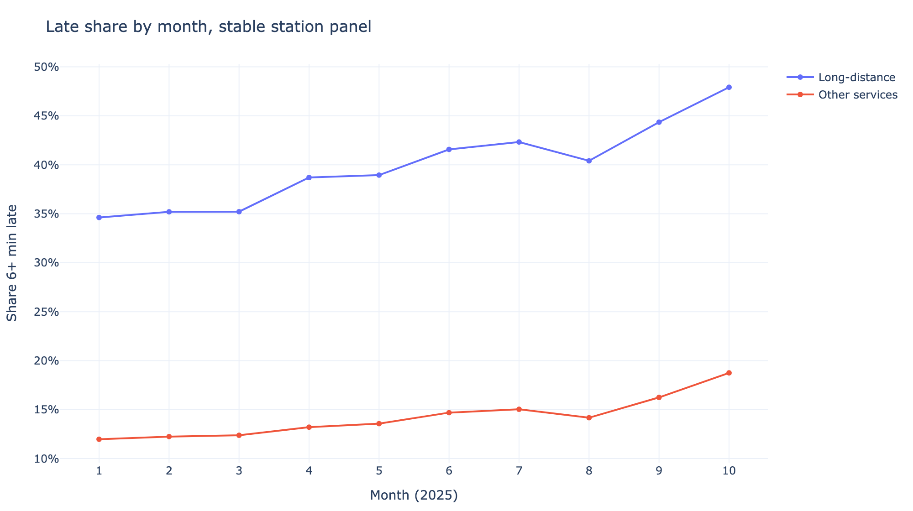
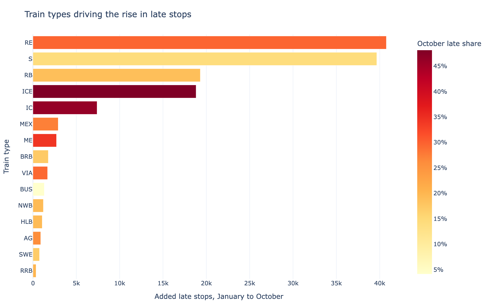

# BahnDelayStory

**Deutsche Bahn trains got later through 2025.** On a stable panel of
`[TODO]` large stations, the share of stops at least 6 minutes late rose from
`[TODO]`% in January to `[TODO]`% in October. High-volume regional services
added the most late stops, even though long-distance trains have the highest
late share *(confirm after re-run)*.





The full write-up with all eight findings is in [REPORT.md](REPORT.md).

## What's Inside

- A DuckDB pipeline that cleans about `[TODO]`M stop events and checks keys,
  delay bounds, late-flag consistency and share ranges on every run.
- Notebooks for exploration (`01_eda`), the stable-panel analysis
  (`02_analysis`) and interactive chart export (`03_post_figures`).
- `bahn-figures`, which exports the report figures as PNG files.
- A Streamlit dashboard with train-type filters, a weekday/hour heatmap and a
  service ranking. It shows the stable panel by default, with a toggle for all
  data.

Built with Python 3.11+, DuckDB, pandas, Plotly, Streamlit, Jupyter and
Hugging Face Hub.

## Getting Started

Install [uv](https://docs.astral.sh/uv/), then run from the repository folder:

```bash
uv sync
uv run bahn-download --allow-pattern "monthly_processed_data/data-2025-*.parquet"
uv run bahn-pipeline
uv run bahn-figures
uv run streamlit run app.py
```

The [source dataset](https://huggingface.co/datasets/piebro/deutsche-bahn-data)
is large. For a quick pipeline run, add `--sample-limit 1000000`. This reads the
first rows only and is not a representative sample.

`bahn-figures` writes PNG files to `reports/figures/` using Kaleido, which needs
Chrome or Chromium. If neither is installed, run `uv run plotly_get_chrome` once.

Run `uv run jupyter lab` to open the notebooks in order. Raw data and processed
tables stay local.

## Method Notes

Station coverage expands from about 100 stations to all stations in November
2025, so trend claims use stations present in every month January–October.
Late share counts cancelled stops as not late and leaves out stops with an
unknown delay. Delay minutes cover non-cancelled stops only. The analysis is
descriptive. See [DATA.md](DATA.md) for metric definitions, limitations and
data attribution.

## Development

```bash
uv sync --extra dev
uv run pytest
uv run ruff check .
```

CI runs both on every push to `main` and on pull requests.

Code in this project is MIT unless changed later. Data licensing follows the
source dataset; its attribution notice is in [DATA.md](DATA.md).
