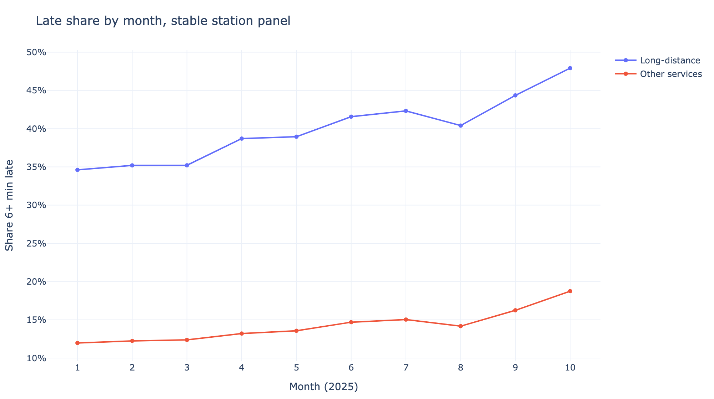
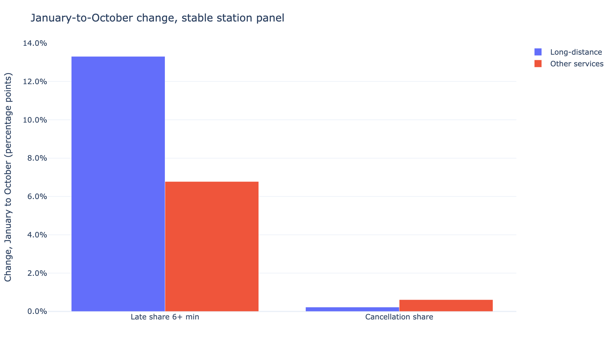
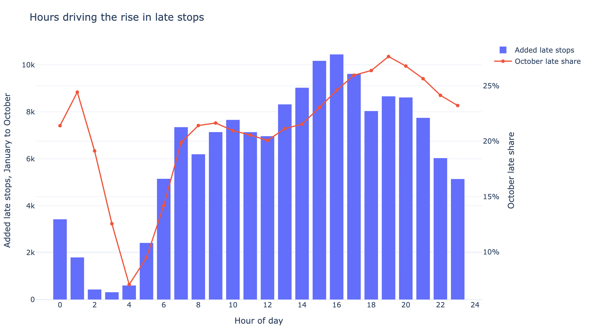
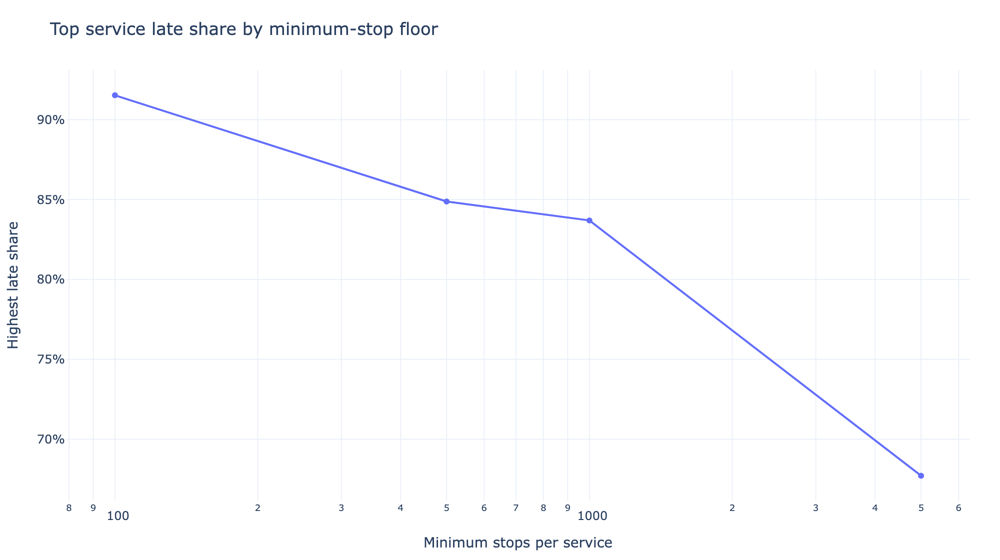
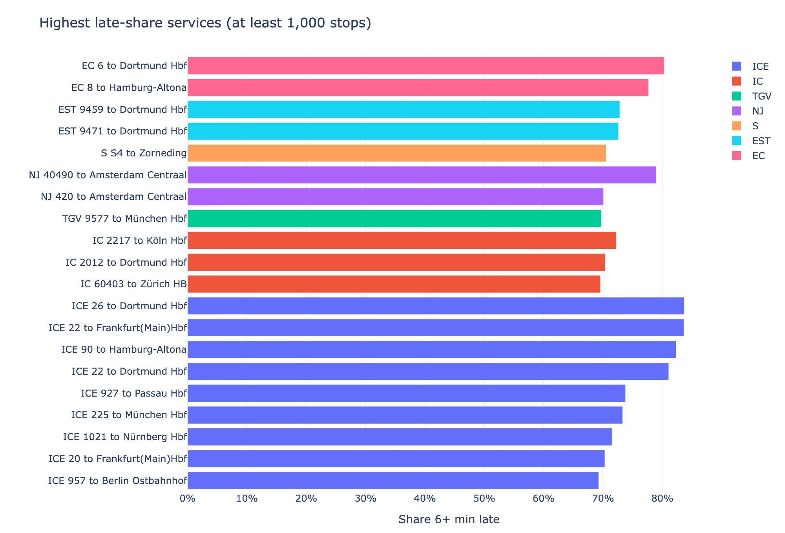

# BahnDelayStory Report: Deutsche Bahn Delays in 2025

## Scope and Method

- **Data:** 49,681,904 stop-level Deutsche Bahn events for 2025 from
  [`piebro/deutsche-bahn-data`](https://huggingface.co/datasets/piebro/deutsche-bahn-data)
  (`monthly_processed_data/`, CC BY 4.0). See [DATA.md](DATA.md) for columns and
  attribution.
- **Stable panel:** source coverage expands from 107 large stations to more than
  5,000 in November 2025. Trend claims use only the 107 stations present in
  every month January–October 2025, dated January–October: 19,849,883 stops.
- **Late share:** stops at least 6 minutes late divided by stops with a known
  late status. Cancelled stops count as not late; stops with a missing or
  out-of-range delay are left out (137,538 stops in 2025).
- **Cancellation:** a stop counts as cancelled if its arrival or its departure
  is cancelled, including partial cancellations.
- **Change measures:** January versus October on the stable panel. "Added late
  stops" is October's late-stop count minus January's; the panel had 294,131
  late stops in January and 442,606 in October, so 148,475 were added on
  similar volume (2,035,582 and 2,018,378 stops).
- **Descriptive only:** no controls for weather, strikes, construction or
  passenger demand. Stop rows from the same train are correlated.

Regenerate the figures with `uv run bahn-pipeline` and then `uv run bahn-figures`.

## Findings

### 1. Late share rose from January to October

On the stable panel, the 6+ minute late share rose from 14.4% in January to
21.9% in October 2025. For long-distance trains it went from 34.6% to 47.9%; for
other services from 12.0% to 18.8%. The rise was not steady: both segments dipped
in August before climbing to their highest level in October. Long-distance trains
were later than other services in every month.

### 2. Delays worsened far more than cancellations

From January to October, late share rose by 13.3 percentage points for
long-distance trains and 6.8 points for other services. Cancellation share moved
by 0.2 and 0.6 points (4.9% to 5.1%, and 4.0% to 4.6%). Cancellations peaked in
June and July instead (9.5% of long-distance stops in July), so they follow a
different pattern from delays and are reported separately.

### 3. High-volume regional services add the most late stops

RE, S and RB services added 40,763, 39,660 and 19,300 late stops: 99,723
together, 67% of the panel's increase. ICE added 18,815 (13%) and IC 7,391 (5%).
Regional operators that the source lists under their own codes (MEX, ME, BRB,
VIA, NWB, HLB and others) add more on top, so the 67% understates the regional
share.

### 4. Late-share rate and contribution are different rankings

ICE had the highest October late share of any train type with at least 10,000
October stops, at 48.1%, followed by IC at 46.2%. RE's late share was much lower
at 29.6% and S at 14.2%, yet each added more than twice as many late stops as
ICE, because they run far more stops (362,261 RE and 825,735 S stops in October,
against 156,776 ICE stops). The colour scale in the figure above shows both
measures.

### 5. The rise is broad, with the largest increases at major hubs

Late stops rose at 102 of the 107 panel stations. The largest increases were at
Stuttgart Hbf (+7,697), Hamburg Hbf (+6,026), München Hbf (+5,960), Köln Hbf
(+5,165) and Berlin Hauptbahnhof (+4,057). These five account for 19.5% of the
added late stops while handling 12.9% of October stops, so the big hubs worsened
somewhat more than their size alone would explain. The increase is still mostly
network-wide, not driven by a few stations. Five stations improved, most
noticeably Bochum Hbf (−2,777) and Berlin Südkreuz (−1,341).

### 6. Afternoon and evening hours drive the increase

Late share rose in every hour of the day. Hours 14:00–21:59 account for 48.7% of
the added late stops but 42.1% of October stops; the largest single-hour
increases were 15:00 and 16:00 (about 10,200 and 10,400 added late stops each).
Overnight hours 00:00–05:59 contribute 6.1% of the increase against 9.7% of
stops, so the rise is not driven by low-volume night cells.

### 7. Service rankings depend on the minimum-stop floor

The highest service late share is 91.5% with a 100-stop floor, 83.7% with a
1,000-stop floor and 67.7% with a 5,000-stop floor. Rankings of small services
are noisy, so headline service examples use a floor of at least 1,000 stops.

### 8. The latest high-volume services are long-distance

Among services with at least 1,000 stops in 2025, 19 of the 20 with the highest
late share are long-distance; the exception is the Munich S-Bahn S4 towards
Zorneding (70.5%). The highest is ICE line 26 towards Dortmund Hbf at 83.7%.
Services are grouped by line where the source gives one, so an ICE "service" can
cover many individual trains. These are examples, not causal explanations.

## Limitations

- Stop-level counts weight busy hubs and small halts equally per stop event.
- The stable panel covers 107 large stations, so it does not represent the
  whole network.
- Service rankings (findings 7 and 8) use all 2025 data, including the
  November–December coverage expansion.
- The broad cancellation rule counts partial cancellations, about 0.4% of
  stops, as cancelled.
- Train types mix product codes (RE, RB, S) with operator codes (HLB, VIA,
  SBB), so per-type rankings split some regional services across codes.
- Missing API calls can create gaps in coverage that the panel does not detect.
