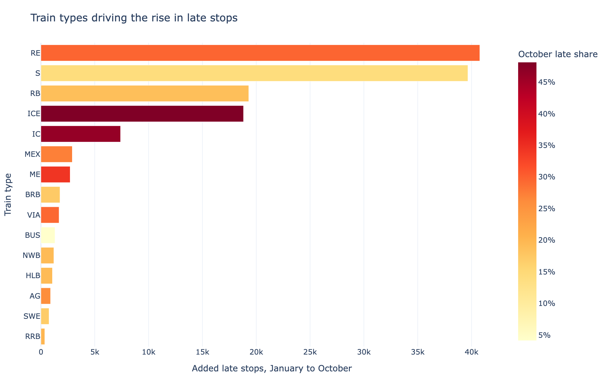
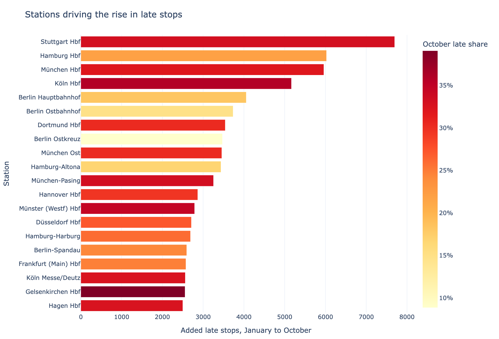
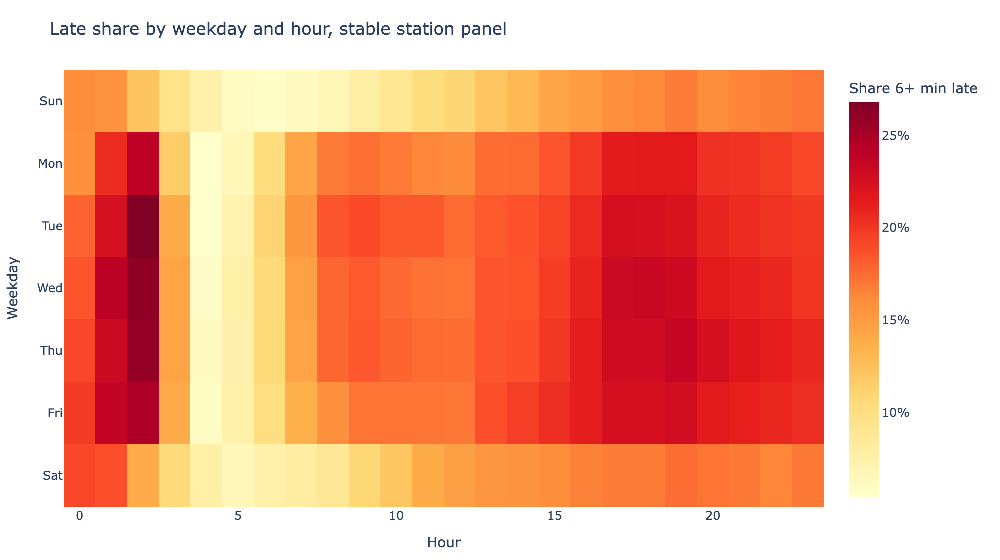

# BahnDelayStory Report: Deutsche Bahn Delays in 2025

> **Status: draft.** Numbers marked `[TODO]` must be filled in from a run of
> `notebooks/02_analysis.ipynb` on the full 2025 data. Statements marked
> *(confirm)* come from an earlier analysis run made before the metric
> definitions below were tightened; check each against the new run.

## Scope and Method

- **Data:** stop-level Deutsche Bahn events for 2025 from
  [`piebro/deutsche-bahn-data`](https://huggingface.co/datasets/piebro/deutsche-bahn-data)
  (CC BY 4.0). See [DATA.md](DATA.md) for columns and attribution.
- **Stable panel:** source coverage expands from about 100 large stations to all
  stations in November 2025. Trend claims use only stations present in every
  month January–October 2025, dated January–October (`[TODO]` stations,
  `[TODO]` stops).
- **Late share:** stops at least 6 minutes late divided by stops with a known
  late status. Cancelled stops count as not late; stops with a missing or
  out-of-range delay are left out.
- **Delay minutes:** mean, median and p90 over non-cancelled stops only.
- **Descriptive only:** no controls for weather, strikes, construction or
  passenger demand. Stop rows from the same train are correlated.

Regenerate the figures with `uv run bahn-figures`.

## Findings

### 1. Late share rose from January to October

On the stable panel, the 6+ minute late share went from `[TODO]`% in January to
`[TODO]`% in October 2025 for long-distance trains, and from `[TODO]`% to
`[TODO]`% for other services. Long-distance trains stay above other services
throughout *(confirm)*.

### 2. Delays worsened more than cancellations

From January to October, late share changed by `[TODO]` percentage points and
cancellation share by `[TODO]` points (long-distance); `[TODO]` and `[TODO]`
points for other services. The rise in delays is larger than the change in
cancellations *(confirm)*, so cancellation is reported as a separate metric.

### 3. High-volume regional services add the most late stops

The train types adding the most late stops from January to October are
`[TODO: top train types]`. High-volume RE, S and RB services contribute
alongside ICE and IC *(confirm)*: `[TODO]` added late stops from the top three
types, `[TODO]`% of the total increase.

### 4. Late-share rate and contribution are different rankings

ICE has an October late share of `[TODO]`%, among the highest of any type
*(confirm)*. Lower-rate types with far more stops still add more late stops
(`[TODO]` for `[TODO: type]` versus `[TODO]` for ICE). The colour scale in the
figure above shows both measures together.

### 5. Added late stops concentrate at major hubs

The stations adding the most late stops are `[TODO: top stations]`; together
they account for `[TODO]`% of the panel's increase.

### 6. Afternoon and evening hours drive the increase

Hours `[TODO]`–`[TODO]` account for `[TODO]`% of the added late stops. The
increase is concentrated in afternoon and evening hours *(confirm)*, not in
low-volume overnight hours.

### 7. Service rankings depend on the minimum-stop floor

The highest service late share is `[TODO]`% with a 100-stop floor and `[TODO]`%
with a 5,000-stop floor. Rankings of small services are noisy, so headline
service examples use a floor of at least 1,000 stops.

### 8. The latest high-volume services are mostly long-distance

Among services with at least 1,000 stops, `[TODO]` of the 20 with the highest
late share are long-distance *(confirm)*. The highest is `[TODO: service]` at
`[TODO]`%. These are examples, not causal explanations.

## Limitations

- Stop-level counts weight busy hubs and small halts equally per stop event.
- The stable panel covers large stations only, so it does not represent the
  whole network.
- Service rankings use all processed data, including November–December.
- Missing API calls can create gaps in coverage that the panel does not detect.
